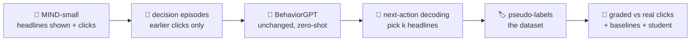

<p align="center">
  
</p>

<h1 align="center">distilling-significance</h1>

<p align="center">
  <b>Can a behaviour model guess which headlines <i>you</i> will click, with zero training?</b><br>
  <sub>🏁 Built at <b>Hack 148</b>, a hackathon held by <b>Sundai</b></sub>
</p>

<p align="center">
  
</p>

> 👋 Hi, I'm **Sig**, a tiny drop of distilled *significance*. Significance means what a
> person chooses to pay attention to. This repo squeezes that out of an off-the-shelf
> behaviour model and turns it into a labelled dataset. Let me show you around!

---

## ⚡ What this project does

1. **📰 Show people headlines.** We use [MIND](https://msnews.github.io/), a real log of
   Microsoft News readers: which headlines each person was shown, and which ones they
   clicked.
2. **🤖 Ask the model to play the person.** We hand each person's earlier clicks to
   **BehaviorGPT**, Unbox AI's behaviour model, completely unchanged, and ask: *"which of these
   headlines would you open next?"*
3. **🏷️ Keep its picks as labels.** BehaviorGPT's choices become **pseudo-labels**: a dataset
   of *predicted human attention decisions*.
4. **📏 Check every pick against reality.** The clicks being predicted are never shown to the
   model. We use them only to grade it, against simple baselines, and to see whether a small
   student model can learn from the pseudo-labels.

## 🤔 Why it's interesting

- **Attention labels are expensive.** Knowing what a human finds worth their attention
  usually means collecting clicks, ratings or annotations.
- **Behaviour models already know a lot about it.** BehaviorGPT is pretrained to predict what
  people do next. If it can predict attention zero-shot, labels come almost for free.
- **It's a fair test.** The ground truth is what real people actually did, not what another
  model thinks. So we can see exactly where the idea works and where it doesn't.

## 🛠️ How it works



- **🧩 Episodes.** One impression is one decision. The model sees the person's earlier clicks:
  their MIND click history plus earlier impressions, from **earlier days only**. No peeking at
  the future.
- **🏷️ Headlines as items.** Every headline (65,238 of them) becomes a text-only item in a
  private Unbox AI catalog: title, category, entity names.
- **🧪 Representation (the winner: V1o).** Earlier clicks are written as *"viewed it, then
  picked it"*.

  We tried three ways on 1,000 held-out impressions:
  - V1 *views* the clicked headlines;
  - **V1o** adds an *order* of them;
  - V2 also shows the headlines the person *skipped*.

  V1o won, by a hair over V1.
- **🎯 Next-action decoding.** BehaviorGPT ranks the headlines on screen. The top pick counts
  as "opened", gets added to the session, and the rest are ranked again.
  - This repeats *k* times, where *k* comes from the person's own past click rate (at least
    1).
  - The model has no "skip everything" button, so it can't decide the count itself.
- **📏 Grading.**
  - AUC, MRR, nDCG, F1 and κ against the real clicks, with bootstrap confidence intervals
    over persons.
  - Four baselines.
  - With and without history.
  - A distilled student classifier.

## 📊 Results so far

**Scoreboard:** 5,000 validation-day impressions (R1), per-impression AUC (0.5 = coin flip):

| Who's guessing? | AUC |
|---|---|
| 🎲 Random | 0.500 |
| 🕰️ Recency (newest first) | 0.510 |
| 🤖 BehaviorGPT, *no* history | 0.523 |
| 🔤 Content similarity (TF-IDF vs your past clicks) | 0.557 |
| 🤖 **BehaviorGPT + your click history** | **0.600** [0.591, 0.609] |
| 🔥 Popularity (earlier click rate) | 0.658 |

**The honest takeaways:**

- ✅ **It works, zero-shot.** BehaviorGPT reads your past clicks and beats chance and text
  similarity, without any training.
- ✅ **Your history is the secret sauce.** It adds +0.078 AUC over no history.
- ❌ **Popularity still wins.** News attention is mostly "what's hot right now", and
  BehaviorGPT sees no popularity signal at all (on purpose: the catalog has none).
- 🟡 **Distillation is halfway there.** A small student trained on the pseudo-labels recovers
  **41 %** of what real labels teach it; the target was 50 %.
- 🧪 **Plot twist.** Telling the model which headlines you *skipped* made it **worse**
  (−0.029 AUC), because to the API every view looks like interest.

**Status:**

- ✅ **R1 is done.** 5,000 impressions labelled, 20,348 API requests, 0 failures, and
  every label can be reproduced from the response cache with no new calls. Full write-up:
  [`reports/R1_results.md`](reports/R1_results.md).
- 🏗️ **Scaling up to 25,000 impressions.** That's 17,053 from MIND-small's training file and
  7,947 from its validation file, in the files' own proportion. All earlier labels are
  reused; labelling the new ones is in progress, and the results will land here.

## 🗂️ The dataset

<p>
  
  &nbsp;
  
</p>

> 🗞️ Meet **Pip**, a headline wearing its pseudo-label sticker. Every row of the dataset is a
> Pip: *"BehaviorGPT thinks this person opens this headline: yes or no."*

It's stored locally in `dataset/`, which is git-ignored and never pushed or shared:

| File | What's in it |
|---|---|
| `train.parquet` | impressions from MIND-small's training file |
| `validation.parquet` | impressions from MIND-small's validation file |
| `metadata.json` | scope, splits, schema, record-id ranges, method, API usage, checksums |

Each file has exactly six columns:

| Column | Meaning |
|---|---|
| `record_id` | which impression (decision episode) the row belongs to |
| `news_id` | the MIND headline id |
| `predicted_attention` | **the pseudo-label**: 1 if BehaviorGPT predicts a click, else 0 |
| `attention_rank` | the order in which BehaviorGPT picked the headlines (1 = first) |
| `confidence` | 1 − (rank − 1) / headlines shown |
| `variant` | how the history was written (`V1o`) |

🙅 **No user ids, no timestamps, no headline text, no real clicks** in the files. A schema
check enforces it. Details are in the data card, [`DATACARD.md`](DATACARD.md).

## 🚀 Run it yourself

**You'll need:**

- **MIND access.** Accept the MIND licence on Hugging Face
  ([`yjw1029/MIND`](https://huggingface.co/datasets/yjw1029/MIND)) and get a read token.
- **An Unbox AI API key.** It's free at [portal.unboxai.com](https://portal.unboxai.com).
- **A `.env` file** in the project folder, holding `UNBOXAI_API_KEY=...` and `HF_TOKEN=...`.
  It's git-ignored; never commit it.
- **Python 3.13** with `pip install -r requirements.txt && pip install --no-deps -e .`.

```sh
python -I scripts/01_prepare.py              # 📥 download + verify MIND-small, draw records
python -I scripts/02_build.py                # 🧩 catalog file + decision episodes
python -I scripts/03_embed.py full           # ☁️ upload the headline catalog (private)
python -I scripts/04_predict.py estimate     # 🧮 exact number of API requests, before spending any
python -I scripts/04_predict.py run --set selection --approved   # 🧪 try V1 / V1o / V2
python -I scripts/04_predict.py select                           # 🏆 pick the best one
python -I scripts/04_predict.py run --set evaluation --approved  # 🏷️ label the impressions
python -I scripts/08_expand.py records       # ➕ draw the extra impressions (25,000 total)
python -I scripts/04_predict.py run --set evaluation_extra --approved  # …and label them
python -I scripts/04_predict.py run --set training_extra --approved
python -I scripts/08_expand.py views         # 🧷 assemble the dataset (no API calls)
python -I scripts/06_dataset.py              # 🗂️ write dataset/
python -I scripts/05_evaluate.py --set dataset_eval   # 📏 grade it
python -I scripts/07_distil.py --set dataset_eval     # 🎓 train the student
```

**Good to know:**

- **💾 Cache.** Every API response is cached, so a stopped run picks up where it left off and
  nothing is paid for twice.
- **🛑 Approval guard.** Big runs refuse to start without `--approved`.
- **🔒 Isolated scripts.** Scripts run with `python -I`, because downloaded data is treated as
  untrusted.
- **Our setup.** In our workspace, `source .temp/env_setup/devenv.sh` activates the venv and
  keeps every cache inside `.temp/`.

<details>
<summary>🧰 Tests, lint and the full step list</summary>

```sh
python -m pytest                       # synthetic data + a fake BehaviorGPT client only
ruff check . && ruff format --check .
```

The complete order of steps, including the trial upload, the probe run and the empty-history
runs, is in [`DATACARD.md`](DATACARD.md#regenerating-the-dataset-locally). The plan behind
everything is [`plans/R1.md`](plans/R1.md).

</details>

## 🧱 Limitations & what's next

**Limitations:**

- 🎯 **The model ranks, it doesn't say yes or no.** So *how many* headlines a person opens
  comes from their past click rate, not from BehaviorGPT. For most impressions that's 1.
- 👀 **There's no "skipped it" signal in the API.** That's why writing skipped headlines
  backfired.
- 🧠 **It reads only about the last 256 events of anyone's history.**
- 📝 **Headlines are text-only.** The model never sees screen position, freshness or time of
  day.
- 🗞️ **One population.** These are US Microsoft News readers from Oct–Nov 2019. News isn't
  shopping, and BehaviorGPT was pretrained on retail, engagement and payments.

**What's next:**

- 🔥 **Give BehaviorGPT a popularity signal**, computed strictly from earlier days, and see if
  it catches up.
- 🤝 **Team it up.** Use BehaviorGPT's personal signal together with popularity, as student
  features or a combined label.
- ⏭️ **Teach it to skip.** Try explicit "attend" / "skip" decision items.
- 🌍 **New data.** Repeat on another news dataset (EB-NeRD), then on shopping data with logged
  impressions.

<details>
<summary>🗺️ Repo map</summary>

```
src/significance/
  config.py            paths, fixed settings, .env loader
  data/mind.py         MIND-small download, checks, safe extraction, readers, statistics
  data/records.py      evaluation / selection / probe records, plus the expansion draws
  catalog.py           headlines -> catalog parquet
  episodes.py          decision episodes, variants V1/V1o/V2/V3, history cap, k rule
  teacher/api.py       BehaviorGPT calls: id filter, chunks, cache, retries, throttle
  teacher/decode.py    next-action decoding -> predicted decisions
  runner.py            estimate, run, choose the variant
  expansion.py         the 25,000-impression dataset as views over the labelled sets
  baselines.py         random, popularity, recency, content similarity
  evaluate.py          metrics and person-bootstrap intervals
  experiment.py        assessing predictors, comparisons, strata
  dataset.py           the six-column dataset files, their checks and metadata
  student.py           the distillation student
  deletion.py          the deletion term
scripts/               01_prepare ... 08_expand, delete_data.py
tests/                 unit tests: synthetic data and a fake BehaviorGPT client only
reports/               aggregate results only
assets/brand/          logos and mascots (Sig and Pip)
```

</details>

## ⚖️ Rights notice (please read)

- **No data in this repository.** The repository contains no MIND data and no label files.
  Raw data, catalogs, decision episodes, caches, real decisions and pseudo-labels stay in
  git-ignored folders (`.temp/`, `dataset/`, `outputs/`) and are never committed or pushed.
- **MIND belongs to Microsoft.** The Microsoft News Dataset (MIND) is licensed under the
  [Microsoft Research License Terms](https://github.com/msnews/MIND/blob/master/MSR%20License_Data.pdf):
  - use for non-commercial, non-revenue-generating research only;
  - **no distribution** of the dataset;
  - results may be published only if no material portion of the dataset is included.

  Anyone who runs this code must get MIND from the official source and accept its licence
  first. This project reads MIND-small from the gated Hugging Face copy `yjw1029/MIND`.
- **The code licence covers code only.** The MIT licence in [`LICENSE`](LICENSE) applies to
  the code in this repository, not to MIND or to any label derived from it.
- **The labels come from BehaviorGPT.** The pseudo-labels are BehaviorGPT's predictions, made
  through the Unbox AI API and subject to Unbox AI's terms. To make them, MIND headlines
  (title, category, subcategory, entity names) are uploaded to a **private** Unbox AI catalog
  under the project owner's API key. Calls are made without a user id, so nothing is recorded
  for any person on the account.
- **Only aggregates are published.** Committed documents, such as reports and the data card,
  hold the method and aggregate numbers only: no headlines, no user ids, no per-impression
  rows.

## 🧹 Deletion term

**What is deleted**

| Item | Where |
|---|---|
| MIND downloads, extracted files and the Hugging Face cache | `.temp/data/` |
| Catalog files, decision episodes, record tables, real decisions (evaluation tables) and predictions | `.temp/data/`, `.temp/work/` |
| The BehaviorGPT response cache | `.temp/cache/` |
| The generated label dataset (and the superseded first version, if present) | `dataset/` (`outputs/`) |
| The project's own Unbox AI catalog (`mind_small_headlines`) | Unbox AI, under the owner's key |

Shared catalogs and catalogs this project did not create are never touched.

**When**

- on request of a rights holder (Microsoft for MIND, Unbox AI for its model outputs);
- if the licence or terms turn out not to allow this use;
- at the end of the project.

**How**

```sh
python -I scripts/delete_data.py            # dry run: lists what would be deleted
python -I scripts/delete_data.py --confirm  # deletes it
```

Manual equivalent, if the script cannot run:

1. Delete the folders `.temp/data/`, `.temp/work/`, `.temp/cache/`, `dataset/` and `outputs/`.
2. Delete the project's catalog with the Unbox AI SDK. List the key's catalogs, then delete the
   one that is `owned` and named `mind_small_headlines`:
   ```python
   from behaviorgpt import UnboxAIClient

   client = UnboxAIClient(market="us")
   [c for c in client.list_catalogs() if c.owned]  # find its catalog_id
   client.delete_catalog("cat_...")  # cannot be undone
   ```

**Commitment:** label files are never redistributed.

## 🙏 Credits

- 🏁 Built for **Hack 148**, held by **Sundai**.
- 🤖 **BehaviorGPT** and its SDK are by [Unbox AI](https://unboxai.com/behaviorgpt).
- 📰 **MIND** is by Microsoft: Wu et al., *MIND: A Large-scale Dataset for News
  Recommendation*, ACL 2020.
- 🎨 Sig and Pip were drawn for this repo as hand-written SVGs; they live in `assets/brand/`.
- 📄 The code is MIT-licensed; see the rights notice above for the data.
